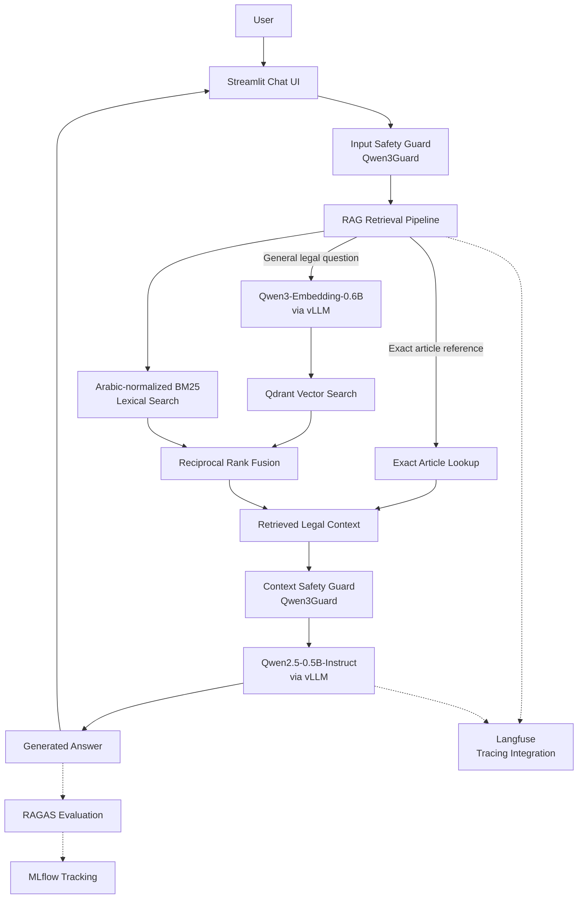

# Egyptian Civil Code RAG

A containerized Retrieval-Augmented Generation (RAG) application for asking questions about the Egyptian Civil Code, Law No. 131 of 1948. The application retrieves legal provisions from a Qdrant vector database and uses Qwen models served through vLLM or host Ollama to generate answers grounded in the retrieved legal text.

The project also includes safety guardrails, MLflow experiment tracking, RAGAS-based evaluation tooling, and Langfuse integration settings for observability.

## Table of Contents

- [Overview](#overview)
- [Architecture](#architecture)
- [Technology Stack](#technology-stack)
- [Prerequisites](#prerequisites)
- [Installation](#installation)
- [Running with Ollama](#running-with-ollama)
- [Starting and Stopping the Services](#starting-and-stopping-the-services)
- [Accessing the Services](#accessing-the-services)
- [Data Ingestion Pipeline](#data-ingestion-pipeline)
- [Environment Variables](#environment-variables)
- [Troubleshooting](#troubleshooting)
- [Project Structure](#project-structure)
- [Limitations and Notes](#limitations-and-notes)

## Overview

This project implements a legal-domain RAG pipeline with the following capabilities:

- **Legal document retrieval:** searches the Egyptian Civil Code using semantic and lexical retrieval, followed by Reciprocal Rank Fusion (RRF).
- **Exact article lookup:** supports direct retrieval when a question explicitly references a legal article.
- **LLM-based answer generation:** uses Qwen2.5-0.5B-Instruct through an OpenAI-compatible vLLM API.
- **Arabic embeddings:** uses Qwen3-Embedding-0.6B to encode queries and legal documents.
- **Safety guardrails:** uses Qwen3Guard to classify user input and retrieved context before answer generation.
- **Vector storage:** persists legal documents and embeddings in Qdrant.
- **Experiment tracking:** provides an MLflow service for tracking experiments, metrics, artifacts, and evaluation runs.
- **RAG evaluation:** includes RAGAS dependencies and evaluation configuration.
- **Observability integration:** includes Langfuse client configuration for tracing where tracing is wired into the application.

The application is intended to support legal information retrieval. It is not a substitute for advice from a qualified Egyptian legal professional.

## Architecture

### Architecture diagram

The editable architecture source is [`egyptian_law_rag_architecture.drawio`](egyptian_law_rag_architecture.drawio).

Open the file in [diagrams.net](https://app.diagrams.net/) to view, edit, or export the original drawing. The following diagram summarizes the main request flow and supporting services.



### Request lifecycle

1. **User interaction:** the user enters a question through the Streamlit chat interface.
2. **Input safety classification:** Qwen3Guard evaluates the input. Requests rejected by the safety classifier do not continue through retrieval.
3. **Retrieval strategy selection:**
   - If the question explicitly references an article, the application attempts an exact article lookup.
   - Otherwise, the application creates a query embedding, performs semantic retrieval against Qdrant, runs BM25 lexical retrieval over the collection, and combines ranked results using Reciprocal Rank Fusion.
4. **Context construction:** retrieved legal records are assembled into a context containing the article number, legal hierarchy or title, and provision text.
5. **Context safety classification:** Qwen3Guard evaluates the retrieved context before it is passed to the answer-generation stage.
6. **Answer generation:** Qwen2.5-0.5B-Instruct receives the question and retrieved context with instructions to answer using the supplied legal text.
7. **Answer presentation:** Streamlit displays the answer and exposes the retrieved documents for inspection.
8. **Evaluation and observability:** MLflow, RAGAS, and Langfuse support their respective experiment-tracking, evaluation, and tracing workflows when configured and invoked.

**Important:** the current guard implementation performs safety classification. It should not be interpreted as a complete legal relevance, factual-grounding, or citation-verification system. Those require separate checks.

### Retrieval details

The RAG implementation uses several complementary retrieval strategies.

| Component | Purpose |
|---|---|
| Exact article lookup | Retrieves a specific article when an explicit article reference is detected. |
| Semantic search | Finds passages with similar embedding representations. |
| BM25 lexical search | Finds passages matching important query terms after Arabic text normalization. |
| Reciprocal Rank Fusion | Combines semantic and lexical rankings into a hybrid result list. |
| Context construction | Formats retrieved provisions for the answer-generation prompt. |
| Safety guard | Classifies input and retrieved context for safety. |

The hybrid approach combines semantic similarity with keyword matching. It does not, by itself, guarantee that the returned provisions are legally relevant or sufficient to answer the question.

## Technology Stack

| Technology | Role |
|---|---|
| Python 3.12 | Application runtime |
| `uv` | Python dependency and environment management |
| Streamlit | User interface |
| vLLM or Ollama | OpenAI-compatible inference endpoints |
| Qwen2.5-0.5B-Instruct | Answer-generation model |
| Qwen3-Embedding-0.6B | Embedding model |
| Qwen3Guard-Gen-0.6B | Safety classification |
| Qdrant | Vector database |
| BM25 and RRF | Hybrid retrieval |
| MLflow | Experiment tracking and artifact management |
| RAGAS | RAG evaluation |
| Langfuse | Optional tracing integration |

## Prerequisites

Install the following before starting:

- Git
- Docker Engine or Docker Desktop
- Docker Compose V2
- `uv`, the Python package and project manager
- `curl`
- Ollama, only when using the host-Ollama workflow

The model-serving containers require sufficient CPU memory and compute resources. Model downloads may take time on the first startup. The Compose configuration also specifies CPU affinity for model services; review the CPU settings if your machine has fewer available CPU cores.

Install `uv` using the [official installation instructions](https://docs.astral.sh/uv/getting-started/installation/).

Verify the prerequisites:

```bash
git --version
docker --version
docker compose version
uv --version
curl --version
```

Ensure Docker is running before proceeding.

## Installation

The project provides two setup scripts. Both automate the same workflow: prepare `.env`, build the `rag-app` image, synchronize the host dependencies, start Qdrant, extract and index the legal dataset, and print the command that starts the complete stack. They differ only in the model-serving backend.

| Script | Inference backend | Compose file | Model services |
|---|---|---|---|
| `setup.sh` | vLLM containers | `docker-compose-dev.yml` | Chat, embedding, and guard models run as vLLM containers in Docker. |
| `setup-ollama.sh` | Ollama on the host | `docker-compose-ollama.yml` | No vLLM containers; only Qdrant and `rag-app` run in Docker, and the models are served by host Ollama. |

Use `setup.sh` for the fully containerized vLLM stack. Use `setup-ollama.sh` when you want the same application to run against an Ollama installation on the host instead of vLLM containers.

Both scripts:

1. Verify the required tools (`setup-ollama.sh` also verifies that Ollama is reachable).
2. Create `.env` from `example.env` when it does not exist; an existing `.env` is preserved and only the backend-specific values are rewritten.
3. Build the `rag-app` Docker image.
4. Run `uv sync --no-dev` to install the host-side dependencies used for ingestion.
5. Start Qdrant, plus the vLLM embedding container in the vLLM workflow, and wait for Qdrant and the embedding endpoint to respond.
6. Extract the legal provisions from the source HTML and validate the generated JSON.
7. Embed the provisions and store them in the `Egyptian_Civil_Law_131` Qdrant collection.

Ingestion re-creates the collection, so the stored vectors always match the embedding model of the selected backend. This matters when you switch between vLLM and Ollama, because the two workflows use different embedding models.

### 1. Clone the repository

```bash
git clone --branch dev-data https://github.com/tarekmokhtarjr/mlops_llm_project.git
cd mlops_llm_project
```

### 2. Provide the legal dataset

The setup scripts do not download the dataset. The source HTML file must already exist before you run either script:

```text
data/egyptian_civil_law_131_1948.html
```

Verify it:

```bash
test -s data/egyptian_civil_law_131_1948.html \
  && echo "Dataset found" \
  || echo "Dataset is missing"
```

### 3. Run the setup script for your inference backend

#### vLLM containers (default)

```bash
./setup.sh
```

This configures the vLLM workflow: it writes the vLLM model and endpoint values to `.env`, builds the `rag-app` image, starts Qdrant and the vLLM embedding service for ingestion, and indexes the dataset. The first run downloads the models and can take several minutes; the script waits up to 15 minutes by default for the endpoints (`MAX_WAIT_SECONDS`).

#### Ollama on the host

Install [Ollama](https://ollama.com/download), start it, and confirm it is reachable:

```bash
curl -fsS http://localhost:11434/api/version
```

Then run:

```bash
./setup-ollama.sh
```

This script writes the Ollama model, endpoint, API-key, and embedding compatibility values to `.env`, pulls any missing models, and then delegates to the shared setup workflow with `docker-compose-ollama.yml`. It does not start vLLM containers. Set `OLLAMA_PULL_MODELS=false` to skip the automatic model pulls.

See [Running with Ollama](#running-with-ollama) for the default model tags and the environment values the script writes.

### 4. Start the complete stack

After the setup script finishes, start the full application with the Compose file for your backend:

```bash
# vLLM
docker compose -f docker-compose-dev.yml up -d

# Ollama
docker compose -f docker-compose-ollama.yml up -d
```

The vLLM stack starts Qdrant, `rag-app`, and the three vLLM model services. On the first startup, wait until the chat, embedding, and guard endpoints respond before using the application. See [Accessing the Services](#accessing-the-services) for the endpoint URLs.

The Ollama stack starts Qdrant and `rag-app` only; the models remain in the host Ollama instance.

### Switching between backends

- Run `./setup.sh` to switch to vLLM, or `./setup-ollama.sh` to switch to Ollama.
- Re-running a setup script rewrites only its backend-specific keys in `.env`; other settings are kept.
- Both scripts re-extract and re-index the dataset. This is required, because the embedding model changes with the backend.
- Do not run both Compose stacks at the same time. They share container names, ports, and the `rag-net` network. Stop one before starting the other:

```bash
docker compose -f docker-compose-dev.yml down
```

### Manual installation

The manual procedure below is the advanced alternative to the setup scripts. Use it when you need to inspect or customize each step.

#### 1. Configure environment variables

Create the local environment file from the example:

```bash
cp example.env .env
```

Edit `.env` if you need to change model names, service ports, tracking configuration, or secrets.

The example values are development defaults. Replace exposed or reused credentials before deploying the project outside a trusted local environment.

Do not commit `.env` or production credentials to Git.

#### 2. Install Python dependencies

```bash
uv sync
```

This installs the dependencies declared in `pyproject.toml`, including development dependencies.

To install only production dependencies:

```bash
uv sync --no-dev
```

#### 3. Prepare the legal dataset

The data-ingestion workflow expects the source HTML file:

```text
data/egyptian_civil_law_131_1948.html
```

The extraction script reads this file and produces:

```text
data/egyptian_civil_law_131_1948.json
```

Verify that the source file exists before continuing:

```bash
test -s data/egyptian_civil_law_131_1948.html \
  && echo "Dataset found" \
  || echo "Dataset is missing"
```

#### 4. Start Qdrant and the embedding service

The ingestion process needs Qdrant and the embedding model to be available.

```bash
docker compose -f docker-compose-dev.yml up -d qdrant embedding
```

Check the service status:

```bash
docker compose -f docker-compose-dev.yml ps
```

Wait for Qdrant and the embedding endpoint to become healthy before running ingestion. Model initialization and the initial model download can take several minutes.

Check Qdrant:

```bash
curl -fsS http://localhost:6333/healthz
```

Check the embedding model endpoint:

```bash
curl -fsS http://localhost:8001/v1/models
```

#### 5. Extract the legal provisions

Run the extraction script:

```bash
uv run python src/app/extract_egyptian_laws.py
```

This extracts the legal records from the source HTML and writes them to the JSON dataset.

Validate that the generated JSON contains records:

```bash
uv run python -c '
import json
from pathlib import Path

path = Path("data/egyptian_civil_law_131_1948.json")
records = json.loads(path.read_text(encoding="utf-8"))

if not isinstance(records, list) or not records:
    raise SystemExit("The extracted dataset is empty or invalid.")

print(f"Validated {len(records)} legal records.")
'
```

#### 6. Embed and index the legal provisions

Run the ingestion script:

```bash
uv run python src/app/embed_and_store_data.py
```

This script:

1. Reads the extracted JSON records.
2. Requests embeddings from the embedding service.
3. Creates the `Egyptian_Civil_Law_131` Qdrant collection.
4. Stores each legal record with its embedding and metadata.

**Warning:** the current ingestion script deletes the existing `Egyptian_Civil_Law_131` collection before recreating it. Back up any data you need before rerunning ingestion.

The ingestion script currently contains its own endpoint, model, Qdrant host, port, and collection constants. If you change the corresponding environment variables, update the ingestion script as well or the ingestion process may continue using its hardcoded values.

#### 7. Start the complete application stack

Once ingestion is complete, start the remaining services:

```bash
docker compose -f docker-compose-dev.yml up -d --build
```

Check the containers:

```bash
docker compose -f docker-compose-dev.yml ps
```

Follow application logs:

```bash
docker compose -f docker-compose-dev.yml logs -f rag-app
```

Follow the logs for an individual model service:

```bash
docker compose -f docker-compose-dev.yml logs -f llm
docker compose -f docker-compose-dev.yml logs -f embedding
docker compose -f docker-compose-dev.yml logs -f llm_guard
```

On the first startup, vLLM may need time to download and initialize the models. Wait until the model APIs are ready before submitting a question through Streamlit.

## Running with Ollama

This workflow runs Ollama directly on the host and runs only Qdrant and `rag-app` in Docker. It uses `docker-compose-ollama.yml`; no vLLM model containers are started.

### Ollama prerequisites

1. Install [Ollama](https://ollama.com/download).
2. Start the Ollama application or `ollama serve`.
3. Confirm it is listening on its default address:

```bash
curl -fsS http://localhost:11434/api/version
```

The default Ollama models are:

| Purpose | Model |
|---|---|
| Chat | `qwen2.5:0.5b` |
| Embeddings | `Qwen3-Embedding:0.6b` |
| Safety guard | `sileader/qwen3guard:0.6b` |

`Qwen3Guard` has no official Ollama library entry. The default guard tag is a community package; review its provenance before using it with sensitive data. Override any tag with `OLLAMA_CHAT_MODEL`, `OLLAMA_EMBEDDING_MODEL`, or `OLLAMA_GUARD_MODEL` before running setup.

### Automated Ollama setup

```bash
./setup-ollama.sh
```

The script:

1. Verifies that Ollama is installed and reachable on `localhost:11434`.
2. Creates `.env` from `example.env` if needed.
3. Writes all required Ollama model, endpoint, API-key, embedding compatibility, and Qdrant collection values to `.env`.
4. Pulls missing models. Set `OLLAMA_PULL_MODELS=false` to skip automatic pulls.
5. Runs the shared setup workflow with `docker-compose-ollama.yml`.
6. Uses `localhost:11434` for host-side ingestion and `host.docker.internal:11434` for `rag-app` inside Docker.

After setup, start the complete Ollama stack:

```bash
docker compose -f docker-compose-ollama.yml up -d
```

If application source code changed, rebuild `rag-app` explicitly:

```bash
docker compose -f docker-compose-ollama.yml up -d --build rag-app
```

To switch back to vLLM, run `./setup.sh`; it restores the required vLLM values in `.env`. Do not run both Compose stacks simultaneously because they share container names, ports, and the `rag-net` network.

### Ollama environment written by setup

```dotenv
OLLAMA_CHAT_MODEL=qwen2.5:0.5b
OLLAMA_EMBEDDING_MODEL=Qwen3-Embedding:0.6b
OLLAMA_GUARD_MODEL=sileader/qwen3guard:0.6b

CHATBOT_MODEL=qwen2.5:0.5b
CHATBOT_SERVER=http://localhost
CHATBOT_SERVER_PORT=11434
CHATBOT_API_KEY=ollama

EMBEDDING_MODEL=Qwen3-Embedding:0.6b
EMBEDDING_MODEL_SERVER=http://localhost
EMBEDDING_MODEL_SERVER_PORT=11434
EMBEDDING_MODEL_API_KEY=ollama
EMBEDDING_CHECK_CTX_LENGTH=false

GUARD_MODEL=sileader/qwen3guard:0.6b
GUARD_MODEL_SERVER=http://localhost
GUARD_MODEL_SERVER_PORT=11434
GUARD_MODEL_API_KEY=ollama

QDRANT_COLLECTION=Egyptian_Civil_Law_131
```

The Ollama Compose file overrides the three model server hostnames with `host.docker.internal`, because `localhost` inside `rag-app` refers to the container itself. The `.env` `localhost` values are used by scripts executed directly on the host.

## Starting and Stopping the Services

Start the full stack:

```bash
docker compose -f docker-compose-dev.yml up -d
```

Rebuild and start:

```bash
docker compose -f docker-compose-dev.yml up -d --build
```

Inspect service status:

```bash
docker compose -f docker-compose-dev.yml ps
```

View all logs:

```bash
docker compose -f docker-compose-dev.yml logs -f
```

Stop the containers without deleting persistent data:

```bash
docker compose -f docker-compose-dev.yml down
```

The named Docker volumes retain Qdrant data, Hugging Face model cache, and MLflow data when containers are stopped or removed normally.

To remove the containers and volumes as well:

```bash
docker compose -f docker-compose-dev.yml down --volumes
```

**Caution:** removing volumes can permanently delete the indexed legal collection, cached models, and stored MLflow data.

For the Ollama workflow, use the same commands with `docker-compose-ollama.yml`, for example:

```bash
docker compose -f docker-compose-ollama.yml ps
docker compose -f docker-compose-ollama.yml logs -f rag-app
docker compose -f docker-compose-ollama.yml down
```

Stopping the Ollama Compose stack does not stop the host Ollama application.

## Accessing the Services

After the containers have started successfully, access the services using the following local URLs.

| Service | URL | Purpose |
|---|---|---|
| Streamlit | [http://localhost:8501](http://localhost:8501) | Ask questions about the Egyptian Civil Code. |
| Qdrant dashboard | [http://localhost:6333/dashboard](http://localhost:6333/dashboard) | Inspect collections, points, and vector database state. |
| Qdrant REST API | [http://localhost:6333](http://localhost:6333) | Access Qdrant's HTTP API. |
| Qdrant gRPC | `localhost:6334` | Access the gRPC endpoint. |
| Chat model API | [http://localhost:8000/v1/models](http://localhost:8000/v1/models) | Inspect the chat model served by vLLM. |
| Embedding API | [http://localhost:8001/v1/models](http://localhost:8001/v1/models) | Inspect the embedding model served by vLLM. |
| Guard model API | [http://localhost:8002/v1/models](http://localhost:8002/v1/models) | Inspect the safety model served by vLLM. |
| Ollama API (Ollama workflow) | [http://localhost:11434/v1/models](http://localhost:11434/v1/models) | Inspect models served by host Ollama. |
| MLflow | [http://localhost:5000](http://localhost:5000) | View experiments, runs, and artifacts. |

The Langfuse web interface is not included in the current `docker-compose-dev.yml` service list. Setting Langfuse environment variables alone does not start a Langfuse deployment. If you configure a separate Langfuse deployment, use its actual URL and valid project credentials.

### Using Streamlit

1. Open [http://localhost:8501](http://localhost:8501).
2. Enter a question about the Egyptian Civil Code.
3. Wait for retrieval and answer generation to finish.
4. Read the generated answer.
5. Expand **Retrieved Documents** to inspect the legal provisions used as context.

For direct article lookup, ask a question that explicitly identifies an article, for example:

```text
ما هو نص المادة 148 من القانون المدني المصري؟
```

For general questions, the application uses hybrid retrieval rather than relying exclusively on an exact article lookup.

### Inspecting Qdrant

Open [http://localhost:6333/dashboard](http://localhost:6333/dashboard) and locate the collection:

```text
Egyptian_Civil_Law_131
```

Check that the collection exists and contains points.

You can also query the collections API:

```bash
curl -fsS http://localhost:6333/collections
```

A running Qdrant container does not necessarily mean that the legal data has been ingested. Verify the collection and point count before testing retrieval.

### Inspecting MLflow

Open [http://localhost:5000](http://localhost:5000).

The tracking server is configured to use the backend store and artifact location specified in `.env`. The existence of the MLflow service does not mean that every Streamlit request is automatically logged as an experiment run; logging depends on the application or evaluation code invoking MLflow.

## Data Ingestion Pipeline

The data preparation and indexing process follows this sequence:

```text
data/egyptian_civil_law_131_1948.html
                 |
                 v
src/app/extract_egyptian_laws.py
                 |
                 v
data/egyptian_civil_law_131_1948.json
                 |
                 v
src/app/embed_and_store_data.py
                 |
                 v
Qwen3-Embedding-0.6B
                 |
                 v
Qdrant: Egyptian_Civil_Law_131
```

Each indexed point stores the embedding alongside payload fields such as:

- `law_number`
- `title`
- `content`

The application uses these fields to retrieve legal provisions and construct the context supplied to the answer-generation model.

The HTML source is the input to the extraction pipeline. The generated JSON is the normalized intermediate dataset, and Qdrant is the vector index used at query time.

## Environment Variables

The following sections document the variables in `example.env`. Unless otherwise stated, host ports are published by Docker Compose and service hostnames are intended for communication between containers on the `rag-net` network.

### 1. Chat model

| Variable | Example | Description |
|---|---|---|
| `CHATBOT_MODEL` | `Qwen/Qwen2.5-0.5B-Instruct` | Model identifier used by the chat client. It should match the model name served by the vLLM chat service. |
| `CHATBOT_SERVER` | `http://llm` | Host or base URL of the chat service. Inside the Compose network, `llm` resolves to the chat container. |
| `CHATBOT_SERVER_PORT` | `8000` | Internal port used to build the OpenAI-compatible API URL. |
| `CHATBOT_API_KEY` | `dumb` | API key passed by the chat client. `dumb` is a development placeholder; configure authentication consistently if the serving endpoint requires it. |

The chat client builds an endpoint of the form:

```text
{CHATBOT_SERVER}:{CHATBOT_SERVER_PORT}/v1
```

For the default Compose network, the resulting URL is:

```text
http://llm:8000/v1
```

### 2. Embedding model

| Variable | Example | Description |
|---|---|---|
| `EMBEDDING_MODEL` | `Qwen/Qwen3-Embedding-0.6B` | Embedding model identifier. It must match the model used to index the documents. |
| `EMBEDDING_MODEL_SERVER` | `http://embedding` | Host or base URL of the embedding service. |
| `EMBEDDING_MODEL_SERVER_PORT` | `8000` | Internal port of the embedding service. |
| `EMBEDDING_MODEL_API_KEY` | `dumb` | API key passed to the embedding endpoint. This is a development placeholder. |
| `EMBEDDING_CHECK_CTX_LENGTH` | `true` | Keeps LangChain's token-length preprocessing for vLLM. Set to `false` for Ollama so embedding requests contain text rather than token-ID arrays. |

The application builds the embedding API base URL using the server, port, and `/v1` suffix.

**Important:** query embeddings and stored document embeddings must use a compatible model and vector dimension. Changing the embedding model generally requires rebuilding the Qdrant collection by re-embedding the documents.

The ingestion script reads these variables from `.env`. During automated setup, the scripts provide host-reachable endpoint values explicitly: port `8001` for vLLM or port `11434` for Ollama.

### 3. Guard model endpoint

| Variable | Example | Description |
|---|---|---|
| `GUARD_MODEL_SERVER` | `http://llm_guard` | Internal hostname or base URL of the Qwen3Guard serving container. |
| `GUARD_MODEL_SERVER_PORT` | `8000` | Internal port of the guard API. |
| `GUARD_MODEL_API_KEY` | `dumb` | API key passed by the guard client. |

The guard client uses these variables to build its OpenAI-compatible endpoint. The internal port is `8000`; from the host, the Compose configuration publishes the guard service on port `8002`.

### 4. Guard container configuration

| Variable | Example | Description |
|---|---|---|
| `GUARD_IMAGE` | `vllm/vllm-openai-cpu:v0.29.0` | Intended Docker image for the guard service. |
| `GUARD_CONTAINER_NAME` | `qwen3-guard` | Intended container name. |
| `GUARD_RESTART_POLICY` | `unless-stopped` | Intended restart policy for the container. |
| `GUARD_PORT_HOST` | `8002` | Host port used to access the guard API. |
| `GUARD_PORT_CONTAINER` | `8000` | Port on which the guard API listens inside its container. |
| `GUARD_VOLUME` | `hf_cache` | Intended named volume for caching downloaded model files. |
| `GUARD_VLLM_CPU_KVCACHE_SPACE` | `1` | Intended vLLM CPU KV-cache configuration. The accepted value and resource implications depend on the installed vLLM version. |
| `GUARD_VLLM_ENABLE_V1_MULTIPROCESSING` | `0` | Intended setting for enabling or disabling vLLM V1 multiprocessing. |
| `GUARD_VLLM_LOGGING_LEVEL` | `INFO` | Intended logging level for vLLM. |
| `GUARD_CPUSET` | `0-7` | Intended CPU affinity setting for the guard container. |
| `GUARD_COMMAND` | `Qwen/Qwen3Guard-Gen-0.6B` | Intended model argument for the guard service. |
| `GUARD_MODEL` | `Qwen/Qwen3Guard-Gen-0.6B` | Model name sent by the application when calling the guard endpoint. |
| `GUARD_HOST` | `0.0.0.0` | Intended bind address for the guard server. |
| `GUARD_PORT` | `8000` | Intended internal listening port for the guard server. |
| `GUARD_MAX_MODEL_LEN` | `2048` | Intended maximum model sequence length. |
| `GUARD_SECURITY_OPT` | `seccomp=unconfined` | Intended Docker security option. Disabling the default seccomp profile weakens container isolation and should be reviewed before production use. |
| `GUARD_CAP_ADD` | `SYS_NICE` | Intended Linux capability to add to the container. |
| `GUARD_NETWORK` | `rag-net` | Intended Docker network for the guard service. |

**Compose implementation note:** in the current `docker-compose-dev.yml`, many guard-container settings are hardcoded directly in the service definition. Their presence in `.env` does not automatically make them configurable. For example, the Compose file specifies the guard image, published ports, model command, cache volume, CPU settings, maximum model length, and network directly.

If you want these variables to control the actual container configuration, replace the corresponding hardcoded values in `docker-compose-dev.yml` with Compose substitutions such as `${GUARD_IMAGE}`.

### 5. Qdrant

| Variable | Example | Description |
|---|---|---|
| `QDRANT_HOST` | `qdrant` | Internal hostname of the Qdrant service. |
| `QDRANT_PORT` | `6333` | Qdrant HTTP API port. |
| `QDRANT_COLLECTION` | `Egyptian_Civil_Law_131` | Name of the collection containing the indexed legal provisions. |

The application must connect to the same collection that the ingestion pipeline populates.

The Compose service publishes Qdrant's HTTP API on host port `6333` and its gRPC endpoint on host port `6334`.

The ingestion script currently hardcodes the Qdrant connection and collection name. Update that script if you need the environment variables to control ingestion as well.

### 6. Streamlit

| Variable | Example | Description |
|---|---|---|
| `STREAMLIT_URL` | `0.0.0.0` | Address on which Streamlit listens inside its container. `0.0.0.0` allows access through the published container port. |
| `STREAMLIT_PORT` | `8501` | Internal and published Streamlit port. |
| `STREAMLIT_APP_PATH` | `src/streamlit_app.py` | Path to the Streamlit entry-point script. |

The Compose configuration publishes the Streamlit port from the container to the host. With the default values, the application is available at `http://localhost:8501`.

### 7. MLflow

| Variable | Example | Description |
|---|---|---|
| `MLFLOW_HOST` | `mlflow` | Internal hostname of the MLflow service. |
| `MLFLOW_PORT` | `5000` | MLflow tracking server port. |
| `MLFLOW_TRACKING_URI` | `http://mlflow:5000` | Tracking URI clients should use when logging experiments or querying runs. |
| `MLFLOW_EXPERIMENT_NAME` | `egyptian-civil-code-rag` | Intended experiment name for application or evaluation code. |
| `MLFLOW_BACKEND_STORE_URI` | `sqlite:////mlruns/mlflow.db` | URI for the MLflow backend store. This example uses SQLite inside the persistent MLflow data volume. |
| `MLFLOW_ARTIFACT_LOCATION` | `/mlruns/artifacts` | Default artifact storage path configured for MLflow. |
| `MLFLOW_ALLOWED_HOSTS` | `mlflow:5000,localhost:5000,localhost` | Hostnames permitted by the MLflow server's allowed-host configuration. Include the hostnames used to access the server in your environment. |

The current Compose configuration starts MLflow on the configured port and mounts a persistent volume at `/mlruns`.

The experiment name is a convention for client code; setting the variable does not automatically create an experiment or log a run.

### 8. RAGAS

| Variable | Example | Description |
|---|---|---|
| `RAGAS_JUDGE_MAX_TOKENS` | `2048` | Intended maximum token budget for the LLM judge's generated output during evaluation. |

This variable is available for evaluation configuration. It only affects evaluation if the relevant RAGAS code reads and applies it.

RAGAS evaluates RAG quality; it is not the runtime safety guard and does not automatically evaluate every user interaction.

### 9. Langfuse application URL

| Variable | Example | Description |
|---|---|---|
| `NEXTAUTH_URL` | `http://localhost:3000` | Public URL used by the Langfuse web application for authentication and callback-related URL construction. This should match the URL at which users access the Langfuse web UI. |

This variable is relevant when running a Langfuse deployment. It is not used to expose Streamlit or Qdrant.

### 10. Langfuse database credentials

| Variable | Example | Description |
|---|---|---|
| `LANGFUSE_POSTGRES_USER` | `langfuse` | Username used by Langfuse to connect to its PostgreSQL database. |
| `LANGFUSE_POSTGRES_PASSWORD` | A generated secret | Password for the Langfuse PostgreSQL user. |

Use a strong, unique password for any persistent or shared environment. These variables only configure a deployment if the corresponding Langfuse database and service definitions consume them.

### 11. Langfuse ClickHouse

| Variable | Example | Description |
|---|---|---|
| `LANGFUSE_CLICKHOUSE_PASSWORD` | A generated secret | Password for the ClickHouse service used by Langfuse for analytical storage. |

The value must match the ClickHouse configuration in the Langfuse deployment. It does not configure a ClickHouse container by itself.

### 12. Langfuse Redis

| Variable | Example | Description |
|---|---|---|
| `LANGFUSE_REDIS_PASSWORD` | A generated secret | Password used to authenticate to the Redis service in a Langfuse deployment. |

Use the same value in the corresponding Redis server configuration and Langfuse connection configuration.

### 13. Langfuse MinIO object storage

| Variable | Example | Description |
|---|---|---|
| `LANGFUSE_MINIO_USER` | `langfuse` | Username or access key for the MinIO object-storage service. |
| `LANGFUSE_MINIO_PASSWORD` | A generated secret | Password or secret key used for MinIO access. |

These variables are relevant only when the configured Langfuse deployment uses MinIO with matching credentials.

### 14. Langfuse application secrets

| Variable | Example | Description |
|---|---|---|
| `LANGFUSE_SALT` | A generated secret | Salt used by Langfuse for applicable hashing or pseudonymization operations. |
| `LANGFUSE_ENCRYPTION_KEY` | A generated encryption key | Key used by Langfuse for encryption operations that require it. Use the length and format required by the installed Langfuse version. |
| `LANGFUSE_NEXTAUTH_SECRET` | A generated secret | Secret used by the Langfuse web application for authentication-session and related cryptographic operations. |

These are security-sensitive values. Generate unique secrets, keep them stable for an existing deployment unless you are deliberately rotating them, and never publish real values in version control.

### 15. RAG application to Langfuse

| Variable | Example | Description |
|---|---|---|
| `LANGFUSE_ENABLED` | `true` | Intended feature flag to enable or disable application tracing. |
| `LANGFUSE_BASE_URL` | `http://langfuse-web:3000` | URL used by the application to reach the Langfuse API. The hostname must resolve from the application's runtime environment. |
| `LANGFUSE_PUBLIC_KEY` | A project public key | Public key for the Langfuse project receiving traces. |
| `LANGFUSE_SECRET_KEY` | A project secret key | Secret key used by the application to authenticate trace ingestion. |
| `LANGFUSE_TRACING_ENVIRONMENT` | `development` | Environment label attached to traces, such as `development`, `staging`, or `production`. |
| `LANGFUSE_DEBUG` | `false` | Intended flag for enabling additional Langfuse integration diagnostics. |

The application needs a reachable Langfuse endpoint and valid project keys for tracing to work. The current Compose file does not start the Langfuse web service, PostgreSQL, ClickHouse, Redis, or MinIO. Configure a separate Langfuse deployment or add the required services before expecting a working local Langfuse UI.

Also verify that the Streamlit request path invokes the tracing-enabled RAG generation flow. Defining credentials alone does not guarantee that every request will produce a trace.

### Environment configuration summary

| Variable group | Main responsibility |
|---|---|
| Chat model | Answer-generation endpoint and model |
| Embedding model | Query-embedding endpoint and model |
| Guard model | Safety-classification endpoint |
| Guard container | Intended Docker and vLLM settings |
| Qdrant | Vector database connection and collection |
| Streamlit | UI entry point and listening port |
| MLflow | Tracking server and storage configuration |
| RAGAS | Evaluation judge configuration |
| Langfuse server | Langfuse web URL and backend-service credentials |
| Langfuse application | Client tracing endpoint, project keys, and environment |

**Configuration rule:** when changing a variable, verify that the Python code or Compose service actually reads it. An environment variable can exist in `.env` without affecting a hardcoded value elsewhere in the project.

## Troubleshooting

### Streamlit is unavailable

Inspect the application container:

```bash
docker compose -f docker-compose-dev.yml ps
docker compose -f docker-compose-dev.yml logs --tail=100 rag-app
```

Verify that `.env` contains the expected Streamlit port and entry-point path.

### Ollama is unavailable or rejects embeddings

Confirm host Ollama and the configured models:

```bash
curl -fsS http://localhost:11434/api/version
curl -fsS http://localhost:11434/v1/models
ollama list
```

Inside Docker, `rag-app` must use `http://host.docker.internal:11434`; host-side ingestion uses `http://localhost:11434`. For Ollama embeddings, `EMBEDDING_CHECK_CTX_LENGTH` must be `false`, otherwise LangChain sends token-ID arrays and Ollama responds with `invalid input type`.

Inspect the resolved Ollama Compose configuration without printing `.env` secrets:

```bash
docker compose -f docker-compose-ollama.yml config --services
docker compose -f docker-compose-ollama.yml exec rag-app printenv EMBEDDING_CHECK_CTX_LENGTH
```

If code changed after the image was built, rebuild `rag-app`; a restart alone does not copy updated source into the image.

### The chat model does not respond

Check the chat service:

```bash
curl -fsS http://localhost:8000/v1/models
docker compose -f docker-compose-dev.yml logs --tail=100 llm
```

Check that the model name and server URL in `.env` match the model served by vLLM.

### The embedding model does not respond

Check the endpoint:

```bash
curl -fsS http://localhost:8001/v1/models
docker compose -f docker-compose-dev.yml logs --tail=100 embedding
```

Confirm that the embedding model has finished initializing and that the application uses the internal service URL and port when running inside Docker.

### The guard rejects requests or cannot be reached

Inspect the guard service:

```bash
curl -fsS http://localhost:8002/v1/models
docker compose -f docker-compose-dev.yml logs --tail=100 llm_guard
```

Verify `GUARD_MODEL`, `GUARD_MODEL_SERVER`, `GUARD_MODEL_SERVER_PORT`, and `GUARD_MODEL_API_KEY`.

A safety rejection is different from a retrieval failure: the application may reject input or retrieved context before the answer-generation stage.

### Qdrant is running, but no useful documents are retrieved

Check the collection list:

```bash
curl -fsS http://localhost:6333/collections
```

Then inspect the collection in the Qdrant dashboard.

Confirm that:

- The collection `Egyptian_Civil_Law_131` exists.
- The collection contains legal records.
- The ingestion script completed successfully.
- The query embedding model matches the model used during ingestion.
- The payload contains the expected `law_number`, `title`, and `content` fields.

A successful Qdrant health check only confirms that the service is responding. It does not prove that the correct legal dataset is indexed or that retrieval is relevant.

### MLflow is unavailable

Check the service:

```bash
curl -fsS http://localhost:5000
docker compose -f docker-compose-dev.yml logs --tail=100 mlflow
```

Verify the configured backend-store URI, artifact location, allowed hosts, and writable persistent storage.

### Langfuse is unavailable

The current Compose file does not define a Langfuse deployment. Confirm that a separate Langfuse instance is running, that `LANGFUSE_BASE_URL` is reachable from the application container, and that the public and secret project keys are valid.

### Resetting the local environment

To stop the services without deleting data:

```bash
docker compose -f docker-compose-dev.yml down
```

To rebuild images:

```bash
docker compose -f docker-compose-dev.yml build --no-cache
docker compose -f docker-compose-dev.yml up -d
```

Avoid removing persistent volumes unless you intentionally want to delete the stored collection, model cache, or MLflow data.

## Project Structure

```text
mlops_llm_project/
├── data/
│   ├── egyptian_civil_law_131_1948.html
│   ├── egyptian_civil_law_131_1948.json
│   ├── egyptian_civil_code_articles_en.json
│   ├── egyptian_civil_law_131_1948_qa.json
│   └── civil_code_eval.json
├── src/
│   ├── app/
│   │   ├── clients/
│   │   ├── models/
│   │   │   ├── chat.py
│   │   │   ├── embedding.py
│   │   │   └── guard.py
│   │   ├── services/
│   │   │   ├── rag.py
│   │   │   └── retrieval.py
│   │   ├── evaluation/
│   │   ├── extract_egyptian_laws.py
│   │   └── embed_and_store_data.py
│   └── streamlit_app.py
├── docker-compose-dev.yml
├── docker-compose-ollama.yml
├── Dockerfile
├── example.env
├── pyproject.toml
├── setup.sh
├── setup-ollama.sh
├── egyptian_law_rag_architecture.drawio
└── README.md
```

This is a representative overview of the main files and directories. The exact contents of individual directories may change as the project evolves.

## Limitations and Notes

- **Legal accuracy:** generated answers depend on the quality and completeness of the indexed source text and retrieved context. Verify legal conclusions against authoritative sources.
- **Retrieval quality:** hybrid search improves coverage but does not guarantee relevance. Retrieval evaluation, ranking improvements, and evidence-sufficiency checks should be considered separately.
- **Safety versus grounding:** Qwen3Guard is used for safety classification. A separate grounding or citation-verification stage is required to verify that generated claims are supported by retrieved articles.
- **Evaluation:** installing RAGAS does not automatically run evaluations. Evaluation datasets, model configuration, and evaluation commands must be configured and invoked.
- **Observability:** Langfuse settings are present in `example.env`, but the current Compose stack does not deploy Langfuse. Tracing also depends on the execution path calling the tracing integration.
- **Environment variables:** several values are hardcoded in Compose or the ingestion script. Check the implementation before assuming that changing `.env` changes runtime behavior.
- **Development configuration:** default passwords and local service URLs are intended for development. Use secure credentials, restrict exposed ports, and review container security settings before deployment.

